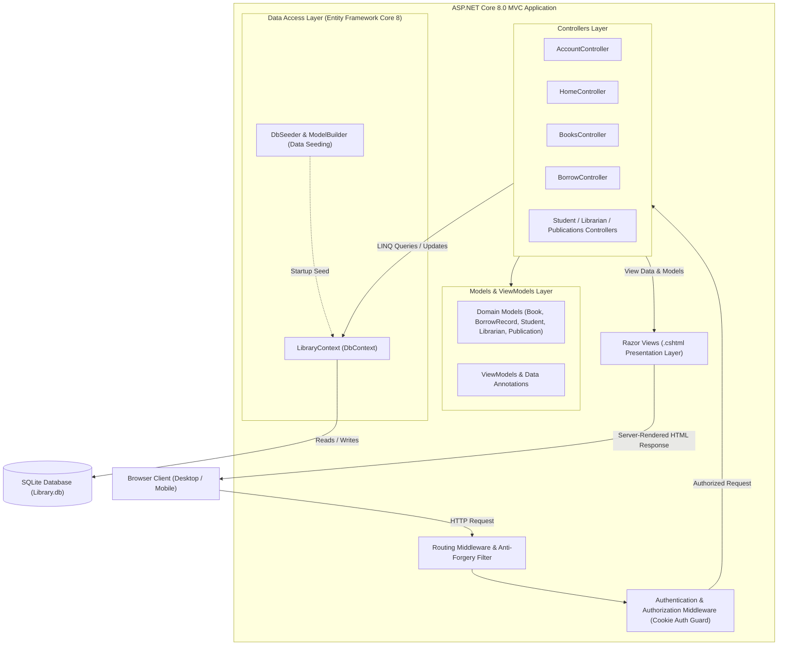

# Library Management System

[](https://dotnet.microsoft.com/)
[](https://dotnet.microsoft.com/apps/aspnet)
[](https://learn.microsoft.com/ef/core/)
[](https://www.sqlite.org/)
[](https://getbootstrap.com/)

**Library Management System** is an academic resource and catalog management web application built with **C#**, **ASP.NET Core 8.0 MVC**, and **Entity Framework Core 8.0**. It provides an institutional portal to catalog books and periodicals, manage book borrowing and return lifecycles with availability validation, maintain student and librarian directory records, and monitor live circulation metrics through an administrative dashboard.

The application uses server-rendered Razor views styled with Bootstrap 5, code-first Entity Framework Core migrations with automated startup data seeding, cookie-based authentication, and a local SQLite database (`Library.db`).

---

## ⚡ Core Engineering Highlights

- **Borrow & Return Lifecycle Engine**:
  - Implements book availability validation: verifies `IsAvailable == true` before issuing any book.
  - Automatically generates a timestamped `BorrowRecord` and marks the book as checked out (`IsAvailable = false`).
  - Return workflow records the completion timestamp (`ReturnDate = DateTime.UtcNow`) and dynamically restores the book's availability for circulation.
- **Administrative Metric Dashboard (`HomeController`)**:
  - Aggregates live catalog statistics: Total Books, Available Copies, Active Borrowed Books, Registered Students, Active Librarians, Periodicals, and Active Borrow count.
  - Displays a chronological activity feed of recent borrow transactions with borrower contact details and book titles.
- **Catalog Search & Server-Side Pagination (`BooksController`)**:
  - Multi-field search querying `Title`, `Author`, and `ISBN` with `AsNoTracking()` LINQ execution for read-optimized performance.
  - Server-side pagination with configurable page limits (`pageSize = 5`) to preserve consistent query response times as catalog size increases.
- **Cookie-Based Authentication & Session Security**:
  - Declarative authorization (`[Authorize]` / `[AllowAnonymous]`) protecting management and mutation routes.
  - Configurable session lifetimes: 2-hour default sliding expiration, extendable to 7 days via persistent session selection (`RememberMe`).
  - Cryptographic password verification using ASP.NET Core Identity's PBKDF2 implementation (`PasswordHasher<object>`).
- **Automated Startup Data Seeding**:
  - Seeds core academic book inventory via Entity Framework Core `OnModelCreating` (`HasData`).
  - Startup seeder (`DbSeeder`) automatically populates initial student records, staff librarians, and periodicals if tables are unpopulated.
- **Data Validation & Anti-Forgery Protection**:
  - Anti-forgery validation tokens (`[ValidateAntiForgeryToken]`) enforced across state-altering form submissions.
  - Comprehensive Data Annotations enforce schema integrity (ISBN regex `^\d{3}-\d{10}$`, email validation, phone number bounds, and required field constraints).

---

## 🏗️ Architecture Overview



---

## 🗄️ Database Schema & Domain Model

The data layer uses **Entity Framework Core 8.0** with code-first migrations against an **SQLite** database (`Library.db`).

| Model | Primary Key | Key Attributes | Relationships | Domain Purpose |
| :--- | :--- | :--- | :--- | :--- |
| **`Book`** | `BookId` (int) | `Title`, `Author`, `ISBN`, `PublishedDate`, `IsAvailable` | `1 : N` with `BorrowRecord` | Physical library book inventory |
| **`BorrowRecord`** | `BorrowRecordId` (int) | `BorrowerName`, `BorrowerEmail`, `Phone`, `BorrowDate`, `ReturnDate` | `N : 1` with `Book` (`BookId` FK) | Circulation and checkout audit log |
| **`Student`** | `StudentId` (int) | `StudentName`, `Email`, `Phone` | Independent entity | Registered student library patrons |
| **`Librarian`** | `LibrarianId` (int) | `Name`, `Age`, `Phone` | Independent entity | Authorized library staff personnel |
| **`Publication`** | `Id` (int) | `Title`, `Publisher`, `PublishedDate`, `Type`, `IsAvailable` | Independent entity | Periodicals (`0 = Newspaper`, `1 = Magazine`) |

---

## 🧭 Controller & Route Mapping

| Controller | Actions Implemented | Authorization | Key Functionality |
| :--- | :--- | :---: | :--- |
| **`AccountController`** | `Login`, `Logout`, `AccessDenied` | Public / `[Authorize]` | Administrator login authentication with cookie issuance and password verification |
| **`HomeController`** | `Index`, `Privacy`, `Error` | Public | Live administrative dashboard with aggregate metrics and recent borrow feed |
| **`BooksController`** | `Index`, `Details`, `Create`, `Edit`, `Delete` | `[Authorize]` | Catalog management with multi-field search (`Title`, `Author`, `ISBN`) and pagination |
| **`BorrowController`** | `Create`, `Return`, `ReturnConfirmed` | `[Authorize]` | Book checkout, availability toggling, borrow record creation, and book return workflows |
| **`StudentController`** | `Index`, `Details`, `Create`, `Edit`, `Delete` | `[Authorize]` | Student member registration and contact record maintenance |
| **`LibrarianController`**| `Index`, `Details`, `Create`, `Edit`, `Delete` | `[Authorize]` | Staff record management with age and contact validation |
| **`PublicationsController`**| `Index`, `Details`, `Create`, `Edit`, `Delete` | `[Authorize]` | Periodicals cataloging with Newspaper / Magazine enumeration |

---

## 🔐 Security Architecture & Controls

- **Authentication Cookie Protection (`HttpOnly`)**:
  The session cookie is configured with `HttpOnly = true`, preventing client-side JavaScript from accessing the authentication ticket and mitigating session theft through Cross-Site Scripting (XSS).
- **Cross-Site Request Mitigation (`SameSite=Lax`)**:
  The authentication cookie specifies `SameSiteMode.Lax`. This restricts cookie transmission on third-party cross-site subrequests (such as embedded cross-site POSTs or images) while allowing the cookie to be sent during top-level navigational GET requests.
- **Anti-Forgery Token Validation (`[ValidateAntiForgeryToken]`)**:
  All state-altering HTTP POST actions (login, book checkout, book returns, and entity mutation forms) are guarded by ASP.NET Core's `[ValidateAntiForgeryToken]` attribute, validating request headers and form fields against encrypted anti-forgery tokens to protect against Cross-Site Request Forgery (CSRF).
- **Cryptographic Password Hashing (PBKDF2 with HMAC-SHA512)**:
  Password verification uses ASP.NET Core Identity's `PasswordHasher<object>`, which implements the default .NET 8 Identity V3 format utilizing PBKDF2 with HMAC-SHA512, 100,000 iterations, a 128-bit cryptographically random salt, and a 256-bit subkey. Passwords are never evaluated or stored in plaintext.
- **SQL Injection Mitigation (LINQ Parameterization)**:
  All database operations are mediated by Entity Framework Core LINQ queries, which compile to parameterized SQL queries on SQLite. User-supplied parameters are bound separately from query logic, preventing SQL injection vulnerabilities.

---

## ⚙️ Configuration & Safe Credential Setup

Configuration settings are loaded from `appsettings.json`, environment variables, or .NET User Secrets.

### Configuration Keys Reference

| Key | Description | Recommended Management |
| :--- | :--- | :--- |
| `ConnectionStrings:DefaultConnection` | SQLite connection string (e.g. `Data Source=Library.db`) | `appsettings.json` / `appsettings.Development.json` |
| `AdminUser:Email` | Administrative account email used to authenticate via `AccountController` | Environment Variable / User Secrets |
| `AdminUser:PasswordHash` | PBKDF2 password hash for the administrative account | Environment Variable / User Secrets |

### Safe Local Configuration Practices

Administrative authentication is configuration-driven rather than stored in the database. To configure or rotate administrator credentials locally without checking secrets into version control:

1. **Use ASP.NET Core User Secrets for local development:**
   ```bash
   dotnet user-secrets init
   dotnet user-secrets set "AdminUser:Email" "admin@example.com"
   dotnet user-secrets set "AdminUser:PasswordHash" "<your-pbkdf2-hash>"
   ```

2. **Generating a PBKDF2 Password Hash:**
   A compatible hash can be generated using standard ASP.NET Core utilities in C# / `dotnet-script`:
   ```csharp
   using Microsoft.AspNetCore.Identity;
   var hasher = new PasswordHasher<object>();
   string hash = hasher.HashPassword(null!, "YourSecurePasswordHere");
   Console.WriteLine(hash);
   ```

3. **Production / Container Deployments:**
   Set environment variables instead of hardcoding values in configuration files:
   ```bash
   export AdminUser__Email="admin@yourinstitution.edu"
   export AdminUser__PasswordHash="<generated-hash>"
   ```

---

## 🚀 Getting Started

### Prerequisites
- [.NET 8.0 SDK](https://dotnet.microsoft.com/download/dotnet/8.0) (verify via `dotnet --version`)
- Visual Studio 2022, Visual Studio Code (with C# Dev Kit), or JetBrains Rider

### Build & Run Instructions

1. **Clone the repository:**
   ```bash
   git clone https://github.com/akshat568/Library-Management-System.git
   cd Library-Management-System
   ```

2. **Restore dependencies:**
   ```bash
   dotnet restore
   ```

3. **Build the project:**
   ```bash
   dotnet build
   ```

4. **Run the application:**
   ```bash
   dotnet run
   ```

5. **Access the application:**
   Open your browser and navigate to the local development endpoints configured in `Properties/launchSettings.json`:
   ```
   https://localhost:7097
   # or
   http://localhost:5079
   ```

---

## 📄 License

This repository does not currently contain a standalone `LICENSE` file. All source code and project assets remain under the author's copyright.
